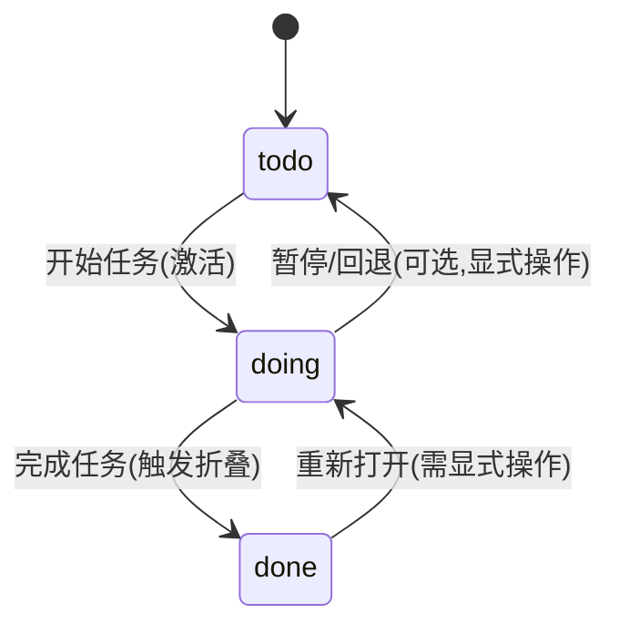
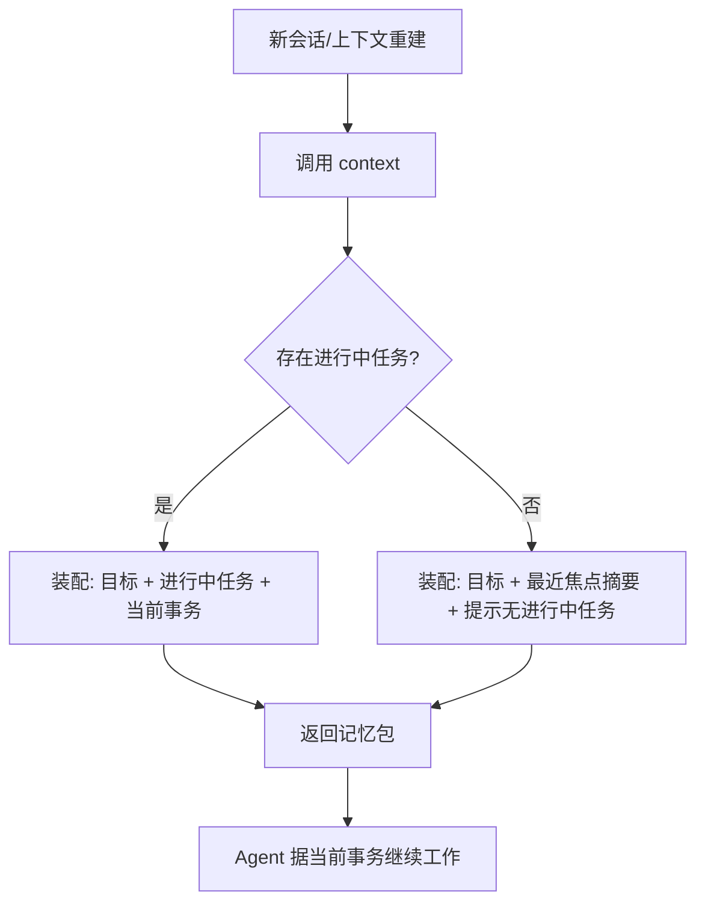
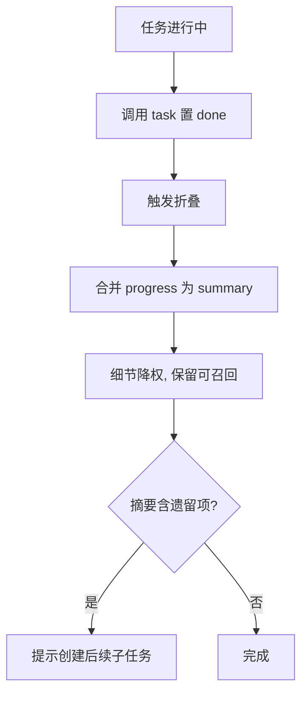
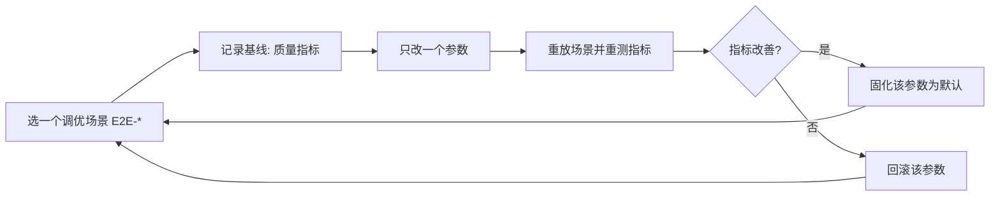

# AI 记忆系统 需求文档(PRD)— 第一阶段

> 状态:第一阶段交付物(需求分析 + 需求文档)
> 关联仓库:<https://github.com/fantasylincen/ai-memory>
> 技术前提见同目录 [`research.md`](./research.md)。
> 本文定义**产品行为与业务规则**(做什么、在什么条件下如何表现),不定义代码级实现。

## 1. 背景与目标

### 1.1 观察到的核心开发工作与目标

本地 AI Agent 在长周期开发任务中会出现三类失效:上下文溢出后被裁剪导致早期目标丢失、重新进入会话时不记得"当前做到哪一步"、多轮迭代后偏离项目终极目标。使用者需要一个跨会话、可检索、可压缩的持久记忆层,并希望以"任务思维导图"的形式显式组织工作。

### 1.2 产品定位

本项目是一个**面向本地 AI Agent 的持久记忆系统**,以 MCP Server 形态接入。它做三件事:

1. **存得住**:把任务、进展、决策、当前事务持久化到本地(Qdrant + 本地语义模型)。
2. **找得回**:按语义 + 状态 + 任务结构混合检索,把最相关的记忆装配进有限上下文。
3. **记得住核心**:始终优先保证"终极目标"与"进行中任务"在上下文里,已完成任务折叠为摘要以释放空间。

### 1.3 目标(可观察)

| 编号 | 观察到的目标 | 完成判据(可观察) |
|---|---|---|
| G1 | Agent 重新进入会话后能立刻知道"当前正在处理的事务" | 一次恢复调用即可获得当前进行中任务及其下一步,无需人工复述 |
| G2 | 长任务进行中不因上下文重建而丢失关键约束 | 关键约束(目标/决策/进行中任务)在每次装配后均存在 |
| G3 | 项目终极目标不漂移 | 装配结果中始终包含项目目标节点 |
| G4 | 已完成任务不再占用上下文正文,但可被召回 | 已完成任务默认只出现摘要;显式检索时才返回细节 |
| G5 | 使用者能人工查看/校正记忆 | 提供人类可读的记忆快照视图与手工修订入口 |

> 本文不设定量指标(如"召回率 ≥ X%"),因为当前无可靠基线。质量评估方法见第 9 章,由使用者在实测中形成基线。

## 2. 用户与使用场景

| 角色 | 是谁 | 与系统的关系 |
|---|---|---|
| 开发者(主角色) | 使用 Trae Agent 进行长时间开发的个人 | 配置系统、查看/修订记忆、以记忆质量为准绳调优 |
| 本地 AI Agent(消费者) | Trae 中的 Agent | 通过 MCP 工具读写记忆,是记忆的主要产出与消费方 |

核心场景:开发者提出一个多阶段开发任务 → Agent 逐步推进并在过程中持续写入任务结构与进展 → 上下文压力上升时系统装配"核心记忆" → Agent 恢复后继续推进 → 阶段任务完成后折叠为摘要 → 直至项目终极目标达成。

## 3. 范围

### 3.1 P0(进入、完成、恢复所必需)

1. **任务思维导图建模**:节点=任务,边=父子关系,节点带状态。
2. **记忆写入**:目标、决策/约束、进行中事务、任务状态变更、进展摘要、任务完成归档。
3. **上下文装配**:按状态分层 + 预算裁剪,产出可注入 Agent 的记忆包。
4. **混合检索**:语义 + 关键词融合,支持按状态/任务/父子范围过滤。
5. **选择性遗忘**:完成即折叠为摘要,细节降权但可召回。
6. **人类可读快照**:可导出/查看记忆导图,并可手工修订。

### 3.2 P1(支撑能力)

- 时间衰减与记忆新鲜度加权。
- 记忆去重与冲突消解。
- 记忆健康度自检(孤儿节点、过期进行中任务)。

### 3.3 明确排除(MVP 不做)

- 多用户、权限体系、云端多租户。
- 图形化思维导图编辑器(仅提供可读快照与文本/JSON 视图)。
- 跨项目记忆共享与迁移。
- 自动代码修改类副作用。

> 排除项仅在可能引起分歧处列出;远期规划不在本阶段范围。

## 4. 核心概念与数据模型(产品视角)

### 4.1 概念定义

| 概念 | 定义 |
|---|---|
| 记忆(Memory) | 一条可检索的原子记录,含文本内容、类型、状态、所属任务、时间与向量 |
| 任务节点(Task Node) | 思维导图中的一个节点,表示一项工作 |
| 父子关系(Edge) | 子任务归属主任务的关系;形成有向树/图 |
| 节点状态(Task Status) | `todo`(未开始)/ `doing`(进行中)/ `done`(已完成) |
| 当前事务(Active Work) | 状态为 `doing` 的任务节点及其关联的最新进展 |
| 项目目标(Project Goal) | 根节点,代表终极目标;生命周期内不被遗忘 |
| 记忆包(Context Bundle) | 一次装配输出的、准备注入 Agent 上下文的记忆集合 |
| 折叠(Fold) | 任务完成后把细节记忆降级、仅保留摘要的动作 |
| 摘要(Summary) | 对一个任务或一次进展的压缩表示 |

### 4.2 记忆类型(枚举)

| 类型 | 说明 | 默认保留策略 |
|---|---|---|
| `goal` | 项目终极目标/阶段目标 | 永久常驻 |
| `decision` | 关键决策、约束、否决项 | 永久,高优先 |
| `progress` | 进展记录(做了什么、结果) | 进行中保留细节 |
| `transaction` | 当前事务指针(下一步要做的事) | 进行中常驻 |
| `summary` | 任务/阶段摘要 | 折叠后作为该任务代表 |
| `artifact` | 产出物引用(文件、提交、结论) | 随任务 |

### 4.3 状态机

任务节点状态与允许的迁移:



规则:
- 任一时刻,同一父任务下应有且仅有有限的 `doing` 子任务(默认建议 1 个,可配置上限,超出时系统提示但允许)。
- 迁移到 `done` 是**折叠的触发条件**(见 FR-05)。
- `done → doing` 为显式操作,用于返工;重开需记录原因。

### 4.4 记忆与任务的关系

- 每条记忆**必须**归属一个任务节点(可为根节点)。
- 一个任务节点可关联多条记忆;其中 `summary` 至多一条作为代表。
- 装配与检索均以任务结构为骨架组织结果。

## 5. 功能需求

### FR-01 项目初始记忆与目标锚定

**目的**:建立"终极目标"这一永不遗忘的锚点。

**触发**:Agent 首次对某项目调用初始化,或显式调用 `remember` 写入 `goal` 类型记忆。

**处理规则**:
- 首次初始化时,要求至少提供一条 `goal`(项目终极目标)。
- 根节点自动创建,其代表记忆为 `goal`。
- `goal` 类记忆标记为"常驻",不参与折叠、不参与时间衰减降权。

**结果与状态变化**:项目空间建立;根节点状态为 `doing`(项目进行中)。

**异常**:
- 重复初始化同一项目:返回已存在提示,不覆盖,除非显式 `overwrite`。
- 缺少 `goal`:拒绝初始化并提示需提供终极目标。

---

### FR-02 任务思维导图管理

**目的**:让 Agent 能把工作拆解成主/子任务并在其中导航。

**触发**:Agent 调用 `task` 工具(创建/更新状态/查询)。

**处理规则**:
- 创建子任务须指定父节点;根节点唯一。
- 节点字段:`task_id`、`title`、`status`、`parent_id`、`created_at`、`updated_at`、`order`。
- 状态迁移须符合 4.3 状态机;非法迁移被拒绝并返回原因。

**结果与状态变化**:导图结构更新,节点状态与时间戳更新。

**字段表**:

| 字段 | 必填 | 类型 | 默认 | 可编辑 | 校验 |
|---|---|---|---|---|---|
| task_id | 是 | 字符串 | 自动生成 | 否 | 全局唯一 |
| title | 是 | 字符串 | 无 | 是 | 非空,≤200 字符 |
| status | 是 | 枚举 | `todo` | 是 | ∈ {todo,doing,done} |
| parent_id | 否 | 字符串 | 根节点 | 是 | 必须存在;不得成环 |
| order | 否 | 整数 | 自动 | 是 | 同级排序 |

**异常**:
- 父节点不存在:拒绝。
- 形成环(把祖先设为自己的子节点):拒绝并提示。

---

### FR-03 记忆写入

**目的**:把目标、决策、进展、当前事务写进持久记忆。

**触发**:Agent 调用 `remember`。

**处理规则**:
- 入参:内容文本、记忆类型、所属任务、可选标签。
- 写入时计算向量(dense + sparse),存入 Qdrant。
- `transaction` 类型写入视为**更新当前事务指针**:同一任务下后者覆盖前者为"当前",历史保留可追溯。
- 内容为空或超长(超过模型可编码长度)时:空内容拒绝;超长按语义分段并保留段落关联。

**结果与状态变化**:新增记忆记录;所属任务 `updated_at` 更新;若写入 `progress` 且任务为 `todo`,提示是否转 `doing`(不自动强制)。

**校验**:

| 条件 | 行为 |
|---|---|
| 内容为空/仅空白 | 拒绝 |
| 类型非法 | 拒绝 |
| 所属任务不存在 | 拒绝 |
| 内容超过编码上限 | 自动分段,返回分段数 |

**异常与边界**:Qdrant 不可用时,写入进入待重试队列并明确告知 Agent"未持久化",不得静默成功。

---

### FR-04 上下文装配(核心)

**目的**:在 128KB 上下文与单次注入预算内,输出"最该记起"的记忆包。

**触发**:Agent 在会话开始、上下文重建或需要恢复时调用 `context`(可带 `focus` 可选参数指明关注的任务/关键字)。

**处理规则(分层装配)**:
1. **必选层(常驻)**:项目 `goal` + 所有处于 `doing` 的任务节点及其最新 `transaction`。
2. **焦点层**:若给出 `focus`,围绕焦点任务混合检索其相关记忆(含祖先链摘要)。
3. **相关层**:以当前进行中任务为种子做语义近邻召回,按融合分排序。
4. **背景层**:其余已完成任务的 `summary`,按时间/相关度截取。

装配顺序固定为:目标 → 进行中任务 → 焦点相关 → 背景摘要。**在预算耗尽时,从背景层开始丢弃,其次相关层尾部;必选层永不丢弃。**

**预算规则**:
- 装配受"注入预算"约束(以字符/Token 计,默认取上下文窗口的一部分,可配置)。
- 每层设软配额;必选层超过配额时压缩任务描述,但不得删除 `goal`。
- 输出为结构化记忆包,附"为何入选"的来源标注(可追溯)。

**结果与状态变化**:返回记忆包;可选地把"本次装配指纹"写回用于后续去重与评估。

**异常**:
- 无进行中任务:仍返回 `goal` + 最近焦点任务的摘要,并提示"当前无进行中任务"。
- 预算极小:只保证 `goal` 与进行中任务标题。

---

### FR-05 选择性遗忘(折叠)

**目的**:任务完成后释放上下文,但保留可召回的摘要。

**触发**:任务状态迁移 `doing → done` 时自动触发折叠。

**处理规则(遗忘阶梯)**:
| 层级 | 对象 | 处理 |
|---|---|---|
| 保留 | 任务 `summary`、关键 `decision`、产出物引用 | 常驻可召回 |
| 合并 | 该任务的多条 `progress` | 合并为 1 条 `summary` |
| 降权 | 细节 `progress` 正文 | 保留但显著降低检索权重与装配优先级 |
| 释放 | 折叠产生的中间过程(装配痕迹等) | 进入可清理状态 |

- 折叠生成 `summary` 时,由 Agent 提供摘要文本或由系统触发 Agent 生成;摘要须包含"做了什么 + 结果 + 遗留"(遗留非空则提示创建后续 `todo`)。
- **不彻底删除**:细节默认保留在库中,仅在检索排序中降权;真正物理清理须显式操作(见 FR-06)。

**结果与状态变化**:任务 `done`;其代表记忆切换为 `summary`;该任务从"必选层"中移除;若存在 `doing` 的祖先,祖先保持进行中。

**异常**:
- 折叠时无法生成摘要:任务仍置 `done`,但标记"待补摘要",并在装配背景层以标题占位,提示补全。

---

### FR-06 混合检索与召回

**目的**:按需找回历史记忆,包括被折叠的细节。

**触发**:Agent 调用 `recall`;自动装配(FR-04)内部亦使用同一检索。

**处理规则**:
- 检索 = 语义召回(dense)+ 关键词召回(sparse),结果用 **RRF 融合**排序。
- 支持结构化过滤:按记忆类型、任务、状态、父子范围、时间范围。
- 默认只返回未物理删除的记忆;可显式请求包含"已降权细节"。
- 每条结果返回内容、类型、任务、时间、融合分。

**参数表**:

| 参数 | 必填 | 说明 | 默认 |
|---|---|---|---|
| query | 是 | 查询文本 | 无 |
| top_k | 否 | 返回条数 | 10 |
| types | 否 | 记忆类型过滤 | 全部 |
| task_scope | 否 | 任务或子树范围 | 全项目 |
| status | 否 | 任务状态过滤 | 全部 |
| include_folded | 否 | 是否包含已降权细节 | false |
| time_range | 否 | 时间范围 | 不限 |

**异常**:查询为空时返回按状态分层的最近记忆(近似"我做到哪了")。无命中时返回空列表并说明过滤条件,不臆造。

---

### FR-07 人类可读快照与人工修订

**目的**:让使用者能监督与校正记忆。

**触发**:调用 `snapshot` 导出;或使用者直接编辑快照文件后调用导入。

**处理规则**:
- `snapshot` 输出项目记忆导图的可读视图:目标、任务树(含状态)、各任务摘要、进行中事务。
- 支持导出为 Markdown 大纲与 JSON 两种形式。
- 导入修订:以快照为准覆盖对应节点/记忆;冲突时以导入内容为准并记录一条 `decision` 说明修订原因。

**结果与状态变化**:生成快照文件;导入后导图与记忆更新。

**异常**:快照格式非法:拒绝并保持原状,不产生半更新。

---

### FR-08 记忆生命周期与清理

**目的**:控制库增长,同时防止误删。

**触发**:显式调用 `forget`,或到达保留策略阈值时的提示。

**处理规则**:
- 物理清理须为显式操作,且对 `goal`/`decision` 默认禁止清理。
- 清理为**两级**:先"归档"(从检索中排除,可恢复),再"清除"(物理删除,不可恢复)。
- 任何清除前返回将影响的记忆数量并要求确认参数。

**异常**:
- 尝试清除 `goal`:拒绝。
- 批量清除超过阈值:要求二次确认。

---

### FR-09 MCP 工具契约与运行约束

**目的**:固定 Agent 与记忆系统之间的接口,保证可用与可测。

**工具集(P0)**:

| 工具 | 作用 | 对应需求 |
|---|---|---|
| `init_project` | 初始化项目与终极目标 | FR-01 |
| `task` | 创建/更新/查询任务节点 | FR-02 |
| `remember` | 写入记忆(目标/决策/进展/事务) | FR-03 |
| `context` | 装配并返回记忆包 | FR-04 |
| `recall` | 混合检索 | FR-06 |
| `snapshot` | 导出/导入可读快照 | FR-07 |
| `forget` | 归档/清除记忆 | FR-08 |

**运行约束**:
- 以本地 stdio MCP Server 提供,项目级配置于 `.trae/mcp.json`,使用 `${workspaceFolder}` 定位。
- 遵守 Trae 超时约定:`START_MCP_TIMEOUT_MS`、`RUN_MCP_TIMEOUT_MS` 可配;重型首次操作(模型加载)应容忍较长启动时间并在返回中说明状态。
- 所有工具返回结构化结果或明确错误,禁止静默失败。

## 6. 共享规则

### 6.1 优先级总则

记忆在装配中的优先级:

```
goal(项目目标) > transaction(当前事务) > doing 任务约束/decision > doing 任务 progress > done 任务 summary > 降权细节
```

### 6.2 永不遗忘清单

下列内容在生命周期内不得被折叠或自动清理:`goal`、关键 `decision`、未完成任务的 `transaction` 指针。

### 6.3 时间与新鲜度

- 每条记忆带 `created_at`;装配与检索可对 `progress` 应用时间衰减(越新越优先)。
- `goal` / `decision` 不应用时间衰减。

### 6.4 一致性

- 任务标题、状态、父子关系在导图、快照、检索结果中须一致。
- 同一任务至多一条代表 `summary`。

## 7. 关键流程

### 7.1 会话恢复流程



### 7.2 任务完成与折叠流程



## 8. 边界与异常总表

| 场景 | 期望行为 |
|---|---|
| Qdrant 不可用 | 读操作报错;写操作进入待重试并明确告知未持久化 |
| 模型未加载完成 | 返回"初始化中"状态,不阻塞 Agent,可稍后重试 |
| 查询无命中 | 返回空并说明过滤条件 |
| 预算极小 | 仅保 `goal` 与进行中任务标题 |
| 非法状态迁移 | 拒绝并说明当前状态与允许的迁移 |
| 成环/父节点不存在 | 拒绝 |
| 重复初始化 | 提示已存在,除非显式覆盖 |
| 超长内容 | 自动分段,返回分段数 |

## 9. 测试方法

### 9.1 测试环境

- 客户端:Trae Agent(使用 Trae Agent 内 MCP 面板,本地 stdio)。
- 依赖:Qdrant(本地)、本地 BGE-M3、MCP Server 本体。
- 配置:MCP Server 配置写入项目 `.trae/mcp.json`,启用项目级 MCP。

### 9.2 分层测试

| 层级 | 目标 | 方法 | 通过判据 |
|---|---|---|---|
| 单元测试 | 状态机、折叠阶梯、预算裁剪、RRF 融合 | 对纯函数/规则做用例(含非法迁移、环、空查询) | 规则分支全部覆盖,非法输入被拒 |
| 集成测试 | 工具契约 + Qdrant 读写 | 脚本按 FR-09 逐个调用工具,校验返回与库内状态 | 每工具正常/异常路径均可复现 |
| 端到端(人工) | Trae Agent 实际表现 | 见 9.3 场景脚本 | 场景判据全过 |
| 回归 | 变更后不破坏既有行为 | 固化 9.3 场景为可重放脚本 | 无回归 |

### 9.3 端到端场景脚本(在 Trae Agent 中执行)

| 编号 | 场景 | 步骤 | 通过判据 |
|---|---|---|---|
| E2E-1 目标锚定 | 新建项目 | 初始化并给出终极目标;继续多轮其他操作 | 每次 `context` 均包含 `goal` |
| E2E-2 任务拆解 | 拆成多层子任务 | 创建主/子任务,激活其中一条 | 导图结构正确,`doing` 唯一且合理 |
| E2E-3 中断恢复 | 模拟上下文丢失 | 清空会话,重新进入并调用 `context` | 能准确说出当前进行中任务与下一步 |
| E2E-4 完成折叠 | 完成一个子任务 | 置 `done` 并生成摘要 | 该任务细节不再出现在默认装配,摘要可召回 |
| E2E-5 细节召回 | 找回被折叠细节 | `recall(include_folded=true)` | 能找回具体进展细节 |
| E2E-6 目标不漂移 | 长流程后检查 | 多轮任务后检查装配 | `goal` 始终存在且未被改写 |
| E2E-7 异常恢复 | 停掉 Qdrant | 写入记忆 | 明确报告未持久化,重启后可重试 |
| E2E-8 人工修订 | 校正记忆 | 导出快照→修改→导入 | 修订生效且记录原因 |

### 9.4 记忆质量评估(人工 + 半自动)

以"能否支撑 Agent 继续工作"为判据,记录以下可观察信号,逐步形成基线:

| 指标 | 采集方式 | 含义 |
|---|---|---|
| 恢复准确率 | E2E-3 重复若干次,人工判"是否说对当前事务" | 恢复能力 |
| 目标留存率 | E2E-1/6 中 `goal` 出现次数 / 总装配次数 | 锚定能力 |
| 无关注入率 | 人工标注装配结果中与当前任务无关的条目占比 | 精度 |
| 折叠有效性 | E2E-4 后默认装配中细节占比下降幅度 | 遗忘是否生效 |
| 召回可用性 | E2E-5 中找回的细节是否足够继续工作 | 遗忘是否过度 |

## 10. 调优方法

### 10.1 可调参数(建议暴露为配置)

| 参数 | 作用 | 调整方向 |
|---|---|---|
| 注入预算(字符/Token) | 单次装配总容量 | 注入过多无关→调小;关键信息缺失→调大 |
| 各层软配额 | 目标/进行中/焦点/背景占比 | 目标漂移→加大必选层;背景噪声→缩小背景层 |
| `top_k` | 检索返回条数 | 召回不足→调大;噪声多→调小 |
| RRF 融合常数 | 语义/关键词权重平衡 | 中文语义为主偏 dense;标识符/术语精确匹配偏 sparse |
| 时间衰减系数 | `progress` 新鲜度权重 | 近期信息更相关→加大衰减 |
| 折叠触发阈值 | 何时合并 progress | 上下文压力大→更早折叠 |
| 降权幅度 | 折叠后细节的检索权重 | 细节误召回→加大降权;细节召不回→减小 |
| `doing` 并发上限 | 同时进行中任务数 | 事务混乱→限制为 1;并行开发→放宽 |

### 10.2 调优方法(闭环)



原则:**一次只改一个参数**,保留场景重放能力,以第 9.4 节指标判定改善,避免凭感觉调参。

### 10.3 常见症状 → 处置

| 症状 | 可能原因 | 处置 |
|---|---|---|
| Agent 忘记进行中任务 | 优先级/配额不足,或未及时写 `transaction` | 提高必选层配额;约定每步更新 `transaction` |
| 上下文里塞了太多旧细节 | 折叠未触发或降权不足 | 提高折叠阈值触发频率;加大降权幅度 |
| 找不回历史细节 | 降权过大或 `top_k` 过小 | 减小降权;`recall(include_folded=true)`;调大 `top_k` |
| 目标被改写/漂移 | `goal` 被当作普通记忆 | 将 `goal` 置为常驻且禁止折叠(FR-01) |
| 检索命中不准 | 纯语义或纯关键词偏科 | 调整 RRF 权重;核对 sparse 分词对中文/标识符的效果 |
| 内存/延迟升高 | 库增长、模型常驻 | 启用归档策略;模型按需加载 |

## 11. 自检(交付前)

- [x] 产品契约清晰:主角色、触发、核心工作、完成条件明确(第 1–3 章)。
- [x] 范围:所有 P0 服务于"完成或恢复",推测性功能已排除(第 3 章)。
- [x] 可追溯:重要结论来自用户要求、调研结论或已标注假设。
- [x] 需求深度:每个 FR 含触发、处理规则、结果与状态变化。
- [x] 一致性:角色、对象、字段、状态、计算无冲突;状态机单一定义(4.3)。
- [x] 边界:空/失败/取消/重试等已覆盖(第 8 章)。
- [x] 无捏造:未编造指标与业务规则;测试与调优方法为可执行流程。
- [x] 文档纪律:无空泛样板与重复结论。

## 12. 开放问题

| 编号 | 问题 | 影响 | 处理 |
|---|---|---|---|
| Q-1 | 注入预算默认取上下文窗口的多少比例? | 直接影响装配行为 | `[TBD]` 待实测确定,先以可配置为准 |
| Q-2 | 是否需要"多项目/多工作区"隔离? | 数据模型与存储结构 | `[Assumption, TBD]` MVP 按单项目处理,预留 project 字段 |
| Q-3 | Embedding Provider 是否多后端可插拔? | 部署复杂度 | `[Assumption, TBD]` MVP 仅本地 BGE-M3,保留接口 |
| Q-4 | 摘要是 Agent 生成还是系统模板生成? | FR-05 实现路径 | `[TBD]` 倾向 Agent 生成,系统兜底模板 |
| Q-5 | 是否需要自动触发 `context`(如会话开始钩子)? | 使用体验 | `[TBD]` Trae 侧触发方式待确认 |